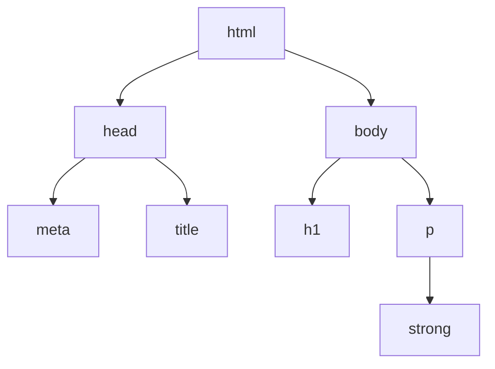

# HTML e CSS: a página que o navegador desenha

## Por que isso importa

Tudo o que o Django entregou até aqui, no fim das contas, é HTML. A lista
de lugares do capítulo de Django é HTML. O admin é HTML. O mapa do
capítulo de GeoJSON é uma página HTML com uma `div` e um script dentro. Até
o Swagger do capítulo anterior é uma página HTML que alguém escreveu. Você
já usou HTML em todos esses capítulos, mas sempre como "aquela parte em
volta do ``", copiada e colada sem muita pergunta.

Este capítulo para para olhar essa parte. O que é uma tag, por que elas se
aninham, o que o navegador faz com o arquivo quando ele chega. E depois o
CSS, que é a linguagem que diz **como** cada pedaço aparece: cor, tamanho,
posição. No meio do caminho vamos entender o que é uma **classe**, a ideia
mais importante do CSS, e por que ela é a peça que os **frameworks CSS**
(Bootstrap, Tailwind e companhia) vendem.

O destino é prático: a página do mapa vai virar um **painel**. Uma barra
no topo, uma coluna lateral com a contagem de lugares e botões para
filtrar por categoria, e o mapa ocupando o resto da tela. Os botões vão
funcionar de verdade, filtrando no servidor, sem uma linha nova de
JavaScript. O próximo capítulo é que vai cuidar do JavaScript; este aqui é
sobre a parte que o navegador desenha.

## O que o navegador faz com um arquivo .html

Um arquivo HTML é texto puro. Dá para abri-lo no navegador sem servidor
nenhum, e é por aí que vamos começar. Crie um arquivo `ola.html` em
qualquer pasta, fora do projeto mesmo:

```html
<!doctype html>
<html lang="pt-BR">
<head>
  <meta charset="utf-8">
  <title>Olá</title>
</head>
<body>
  <h1>Olá, mundo</h1>
  <p>Esta página tem <strong>uma</strong> frase.</p>
</body>
</html>
```

Abra-o no navegador (no macOS, `open ola.html`; no Linux, `xdg-open
ola.html`; ou arraste o arquivo para a janela). A barra de endereço mostra
`file:///...`: nenhum servidor, nenhum Django, só o navegador lendo o
arquivo do disco. Aparece um título grande e uma frase com uma palavra em
negrito.

Cada `<coisa>` é uma **tag**. Uma tag de abertura (`<p>`) e a de fechamento
correspondente (`</p>`) delimitam um **elemento**: uma caixa com um rótulo
que diz o que ela contém. `p` é parágrafo, `h1` é o título principal,
`strong` é texto importante. As caixas se aninham: o `strong` está dentro
do `p`, que está dentro do `body`, que está dentro do `html`. O resultado é
uma árvore:



É essa árvore que o navegador monta ao ler o arquivo, de cima para baixo.
Ela tem nome: **DOM**, *Document Object Model*. Guarde o nome, porque o
próximo capítulo é quase inteiro sobre ela. Depois de montar a árvore, o
navegador calcula o estilo de cada elemento (é aí que o CSS entra),
calcula onde cada caixa fica e qual o tamanho dela (o **layout**), e por
fim pinta tudo na tela. Quando algo muda (uma classe trocada, uma janela
redimensionada), ele refaz a parte que mudou. Você vai ver isso acontecer
daqui a pouco, ao vivo, no DevTools.

Algumas regras do jogo:

- **`<!doctype html>`** na primeira linha diz "isto é HTML moderno". Sem
  ela, o navegador entra num modo de compatibilidade com os anos 1990 e
  algumas medidas de CSS mudam. Sempre coloque.
- **`<head>`** é o que não aparece na página: o título da aba, a
  codificação, os arquivos de CSS e JavaScript a carregar. **`<body>`** é o
  que aparece.
- **`<meta charset="utf-8">`** garante que "Olá" apareça como "Olá" e não
  como "Olá". A mesma lição do capítulo de terminal, do outro lado.
- Algumas tags **não têm fechamento**, porque não têm conteúdo: `<meta>`,
  ``, `<br>`, `<input>`. Escrever `</meta>` é erro.
- **Atributos** vão na tag de abertura, no formato `nome="valor"`: `lang`,
  `charset`, e logo mais `href`, `src`, `id`, `class`.
- Espaços e quebras de linha **não contam**: dez espaços viram um, e uma
  linha em branco entre duas palavras não cria parágrafo. Quem cria
  parágrafo é `<p>`. Isso é o que permite indentar o HTML à vontade.
- Para escrever um `<` que **não** seja tag, use `&lt;`; para `&`, `&amp;`.
  É o tal "escape" do capítulo de Django: quando o template escreve
  `{{ lugar.nome }}`, ele troca esses caracteres por você, e é por isso que
  um nome como `<script>` cadastrado no admin vira texto inofensivo.

Vale dizer: o navegador é **tolerante**. Se você esquecer de fechar um
`</p>`, ele fecha por você e segue em frente; se escrever uma tag que não
existe, ele ignora. Isso é bom para a web (páginas quebradas ainda abrem)
e ruim para quem está aprendendo (o erro não aparece). Quando algo sair
estranho, cole o arquivo no validador do W3C (está nas referências); ele
aponta a linha.

## As tags que você vai usar de verdade

O HTML tem mais de cem tags. Dá para fazer quase tudo com umas vinte:

| Tag                                   | Para quê                                                   |
|:--------------------------------------|:-----------------------------------------------------------|
| `h1` a `h6`                           | Títulos, do maior ao menor; um só `h1` por página          |
| `p`                                   | Parágrafo                                                  |
| `a href="..."`                        | Link; `href` é o destino                                   |
| `strong`, `em`                        | Importante (negrito), ênfase (itálico)                     |
| `ul`, `ol`, `li`                      | Lista sem ordem, com ordem, e cada item                    |
| `img src="..." alt="..."`             | Imagem; `alt` é o texto para quem não vê a imagem          |
| `table`, `tr`, `th`, `td`             | Tabela, linha, célula de cabeçalho, célula                 |
| `form`, `input`, `button`, `label`    | Formulário e seus campos                                   |
| `div`                                 | Uma caixa genérica, de bloco (ocupa a linha toda)          |
| `span`                                | Um trecho genérico, em linha (dentro do texto)             |
| `header`, `nav`, `main`, `aside`, `footer` | Caixas com significado: cabeçalho, menu, conteúdo, lateral, rodapé |
| `script`, `link`, `style`             | JavaScript, arquivo de CSS, CSS embutido                   |

As cinco da penúltima linha fazem exatamente o mesmo que uma `div`, mas
dizem **o que** são. Um leitor de tela pula direto para o `main`; um
buscador entende que o `nav` é menu. Use-as quando couber e `div` para o
resto.

Vamos juntar algumas numa página um pouco mais parecida com o que o
painel vai ser. Salve como `lugar.html`:

```html
<!doctype html>
<html lang="pt-BR">
<head>
  <meta charset="utf-8">
  <title>Café da Esquina</title>
</head>
<body>
  <header>
    <h1>Café da Esquina</h1>
    <nav>
      <a href="lista.html">Lista</a>
      <a href="mapa.html">Mapa</a>
    </nav>
  </header>

  <main>
    <p class="categoria">Café</p>
    <p>Aberto todos os dias, das 7h às 19h.</p>
    <ul>
      <li>Rua Augusta, 1200</li>
      <li>São Paulo, SP</li>
    </ul>

    <form action="busca.html" method="get">
      <label for="q">Buscar lugares</label>
      <input id="q" name="q" type="text">
      <button type="submit">Buscar</button>
    </form>
  </main>

  <aside id="contagem">
    <p>5 lugares abertos</p>
  </aside>
</body>
</html>
```

Abra e veja: tudo empilhado, em preto e branco, com a fonte padrão. É
feio de propósito. O HTML diz **o que** cada coisa é; a aparência é tarefa
do CSS, e ainda não escrevemos nenhum.

Duas coisas nessa página merecem atenção agora. A primeira é o
**formulário**: digite algo e clique em Buscar. O navegador vai para
`busca.html?q=o-que-você-digitou` (vai dar "arquivo não encontrado", não tem
problema). Isso é um formulário com `method="get"`: ele monta uma URL com
os campos e navega até ela. É exatamente o `?bbox=...` e o `?categoria=...`
que as views do `pontos` leem com `request.GET`. Um link `<a href="?categoria=Café">`
faz a mesma coisa sem precisar digitar nada; é assim que os botões do
painel vão funcionar.

A segunda são os dois atributos `class="categoria"` e `id="contagem"`.
Nenhum dos dois muda nada na tela sozinho. Eles existem para o CSS (e o
JavaScript) **encontrarem** o elemento. A diferença:

- **`id`** identifica **um** elemento. Só pode haver um `id="contagem"` na
  página inteira. É o que você usou em `<div id="mapa">`: existe um mapa.
- **`class`** marca uma **família** de elementos. Dez parágrafos podem ter
  `class="categoria"`, e um elemento pode ter várias classes separadas por
  espaço: `class="categoria destaque"`.

Quando em dúvida, use classe. Você vai ver no CSS por quê.

## CSS: regras com seletor e declaração

CSS, *Cascading Style Sheets*, é uma lista de **regras**. Cada regra tem
um **seletor**, que diz a quais elementos ela se aplica, e um bloco de
**declarações** `propriedade: valor;`:

```css
h1 {
  color: #e8590c;
  font-size: 2rem;
}
```

"Todo `h1` fica laranja, com fonte de 2 rem." O `rem` é "vezes o tamanho
da fonte padrão"; `2rem` é o dobro. Dá para usar `px` (pixels), `%` (da
caixa de fora) e `vh`/`vw` (porcentagem da altura e largura da janela:
`100vh` é a tela inteira). Prefira `rem` para texto e `%`/`vh` para
layout; `px` para bordas e detalhes.

### Onde o CSS mora

Há três lugares para pôr uma regra:

1. **No atributo `style`** de um elemento: `<p style="color: red">`. Vale
   só para aquele elemento. É o jeito de testar uma coisa rápida e o pior
   jeito de manter: a regra fica enterrada no meio do HTML.
2. **Numa tag `<style>`** no `<head>`. Foi o que o `mapa.html` fez com
   `#mapa { height: 100% }`. Vale para a página toda.
3. **Num arquivo `.css`** separado, ligado com
   `<link rel="stylesheet" href="estilo.css">` no `<head>`. Vale para
   **todas** as páginas que o incluírem, e o navegador guarda o arquivo em
   cache: baixa uma vez, usa em todas.

A terceira é a boa. Um site tem dezenas de páginas e uma cara só; a cara
fica num arquivo. Crie `estilo.css` ao lado de `lugar.html`, ligue com o
`<link>` e vamos usar a página de exemplo para ver os seletores.

### Seletores

```css
/* por tag: todos os parágrafos */
p {
  line-height: 1.6;
}

/* por classe: o que tiver class="categoria" */
.categoria {
  color: #6b7280;
  text-transform: uppercase;
  font-size: 0.8rem;
}

/* por id: o único elemento com id="contagem" */
#contagem {
  background: #fff7f0;
  padding: 1rem;
}

/* descendente: links que estão dentro de um nav */
nav a {
  margin-right: 1rem;
  color: #e8590c;
}

/* estado: o link quando o mouse está em cima */
nav a:hover {
  text-decoration: underline;
}
```

Recarregue `lugar.html`. O "Café" ficou cinza e em maiúsculas, a lateral
ganhou um fundo claro, os links do menu ficaram laranjas e se afastaram.
Cada seletor é uma pergunta: `.categoria` pergunta "quem tem essa
classe?"; `nav a` pergunta "quem é um `a` dentro de um `nav`?". O ponto é
classe, a cerquilha é id, nada na frente é tag, espaço é "dentro de".
Combinam-se à vontade: `aside p.categoria` é "parágrafo com a classe
`categoria` dentro de um `aside`".

Agora o motivo de preferir classe a id. O seletor `#contagem` só serve para
**aquela** caixa. No dia em que você quiser uma segunda caixa com a mesma
cara, não dá para repetir o id; você vai criar uma classe `.caixa` e
mover as regras para lá. A classe é a unidade de **reuso** do CSS: você
descreve uma aparência uma vez, dá um nome a ela, e aplica a quantos
elementos quiser escrevendo o nome no `class`. Um botão azul é
`class="botao"`; um botão azul grande é `class="botao grande"`. É esse
mecanismo que os frameworks exploram, e chegamos lá em um minuto.

### A cascata

O "C" do CSS. O que acontece quando duas regras dizem coisas diferentes
sobre o mesmo elemento? Três critérios, nesta ordem:

1. **Especificidade**: um seletor com id ganha de um com classe, que ganha
   de um só com tag. `#contagem p` ganha de `.categoria`, que ganha de `p`.
2. **Ordem**: entre regras de mesma especificidade, a **última** ganha. Por
   isso a ordem dos `<link>` no `<head>` importa: o seu arquivo vem
   **depois** do framework, para as suas regras vencerem as dele.
3. O atributo `style` ganha de tudo, e `!important` ganha até do `style`.
   Se você está escrevendo `!important`, pare e procure a regra que está
   disputando; quase sempre é um problema de ordem ou de especificidade.

Além disso, muitas propriedades **herdam**: `color` e `font-family` no
`body` valem para tudo dentro dele, até que alguém sobrescreva. É por isso
que uma regra em `body` muda a fonte da página inteira.

### O box model

Todo elemento é uma caixa retangular, e a caixa tem quatro camadas:

{width=78%}

- **content** é o texto ou a imagem; `width` e `height` dizem o tamanho
  dele.
- **padding** é o respiro **dentro** da borda, com a cor de fundo da caixa.
- **border** é a linha.
- **margin** é o espaço **fora** da borda, transparente, que afasta a caixa
  das outras.

A pegadinha clássica: por padrão, `width: 280px` é a largura **do
conteúdo**; padding e borda somam por fora, e a caixa fica com 308 pixels.
A regra `box-sizing: border-box` muda isso para "280 é o total", que é o
que todo mundo quer. Todo framework a aplica em todos os elementos na
primeira linha; se você escrever CSS do zero, faça o mesmo:

```css
* {
  box-sizing: border-box;
}
```

Cada lado pode ser definido separadamente (`padding-top`, `margin-left`)
ou numa linha só: `margin: 16px` para os quatro lados, `margin: 8px 16px`
para vertical e horizontal.

### Blocos, linhas e flexbox

Por padrão, `div`, `p`, `h1`, `ul` e as tags semânticas são **de bloco**:
cada uma começa numa linha nova e ocupa a largura toda. `a`, `strong`,
`span`, `img` são **em linha**: ficam no fluxo do texto, lado a lado. A
propriedade `display` troca isso, e o valor mais útil dela é `flex`.

Uma caixa com `display: flex` passa a arrumar os **filhos** lado a lado,
dividindo o espaço entre eles. É o jeito moderno de fazer "coluna
lateral + conteúdo" e "itens de menu em linha", coisas que por vinte anos
exigiram truques. Salve como `layout.html`:

```html
<!doctype html>
<html lang="pt-BR">
<head>
  <meta charset="utf-8">
  <title>Layout</title>
  <style>
    * { box-sizing: border-box; }
    body { margin: 0; font-family: sans-serif; }

    .pagina { display: flex; height: 100vh; }
    .lateral { width: 260px; padding: 16px; background: #f1f3f5; }
    .conteudo { flex: 1; background: #d0ebff; }
  </style>
</head>
<body>
  <div class="pagina">
    <aside class="lateral">lateral, 260px</aside>
    <main class="conteudo">conteúdo, o resto</main>
  </div>
</body>
</html>
```

A `.pagina` é o flex container, com a altura da janela. A `.lateral` tem
largura fixa. O `.conteudo` tem `flex: 1`: "fique com todo o espaço que
sobrar". Redimensione a janela: a lateral não muda, o conteúdo estica e
encolhe. É o esqueleto exato do painel. Outras três propriedades do
container resolvem quase todo o resto: `flex-direction: column` empilha em
vez de enfileirar, `gap: 8px` põe espaço entre os filhos, e
`justify-content`/`align-items` alinham (começo, fim, centro, espaçado).

> **Para ver o navegador renderizar.** Abra `layout.html`, clique com o
> botão direito na área azul e escolha **Inspecionar** (ou aperte `F12`).
> Abre o **DevTools**, a ferramenta de desenvolvimento do navegador. À
> esquerda, a aba **Elements** mostra a árvore (o DOM); à direita, o painel
> **Styles** mostra todas as regras que se aplicam ao elemento
> selecionado, da mais específica para a menos, com as perdedoras
> riscadas. Desmarque a caixinha ao lado de `flex: 1`: o conteúdo encolhe
> na hora. Clique no valor `260px`, digite `400px`, aperte Enter: a
> lateral cresce. Nada disso toca o arquivo; ao recarregar, volta. É o
> jeito mais rápido de experimentar CSS, e vale a pena passar dez minutos
> fuçando. No painel **Computed**, ao lado do Styles, aparece o desenho do
> box model do elemento, com os números de cada camada.

## Frameworks CSS: por que existem

Dá para escrever o CSS de um painel do zero. Você acabou de ver o
suficiente para isso. Mas um botão que fique bonito, com borda
arredondada, cor ao passar o mouse, versão desabilitada, três tamanhos e
funcionando igual em todo navegador, são umas cinquenta linhas. Um
formulário alinhado, mais cinquenta. Um menu que vira "hambúrguer" no
celular, mais cem. Todo site precisa dos mesmos cinquenta botões, e um
**framework CSS** é alguém que escreveu essas linhas por você e deu
nomes a elas.

Tecnicamente um framework é só isso: **um arquivo `.css` grande**. O do
Bootstrap, aberto sem compressão, tem 12 mil linhas. Nele estão regras
como:

```css
.btn {
  display: inline-block;
  padding: var(--bs-btn-padding-y) var(--bs-btn-padding-x);
  font-size: var(--bs-btn-font-size);
  /* ...mais umas vinte declarações... */
}

.btn-outline-primary {
  --bs-btn-color: #0d6efd;
  --bs-btn-border-color: #0d6efd;
  --bs-btn-hover-color: #fff;
  --bs-btn-hover-bg: #0d6efd;
  /* ... */
}
```

Você inclui o arquivo com um `<link>` e escreve
`<a class="btn btn-outline-primary">`; pronto, é um botão azul contornado.
As classes são o contrato: o framework promete que `btn` é botão, e você
só precisa aprender os nomes. É o reuso por classe, da seção anterior,
levado ao extremo.

Os que você vai encontrar por aí:

- **Bootstrap** (2011). Nasceu dentro do Twitter, para que as ferramentas
  internas parassem de ter cada uma uma cara. É o mais antigo em uso e o
  mais comum em projetos Django que já existem. Classes com nome de
  **componente** (`btn`, `card`, `navbar`, `alert`), um sistema de grade
  de 12 colunas e alguns componentes com JavaScript (menus, modais).
- **Tailwind** (2017). O oposto: classes **utilitárias**, cada uma faz uma
  coisa só. Um botão é `px-3 py-2 rounded bg-blue-600 text-white`. Não há
  "componente", você compõe. Ganha em liberdade, perde em legibilidade do
  HTML, e para produção precisa de uma etapa de build que descarte as
  classes não usadas (a versão via CDN serve para protótipos). A homepage
  deste livro é feita com ele.
- **Bulma** (2016). Parecido com o Bootstrap na ideia (componentes com
  nome), mas só CSS, sem JavaScript, e construído sobre flexbox desde o
  início.
- **Pico.css** e **Simple.css**. Os "sem classe": você escreve HTML
  semântico puro (`nav`, `article`, `button`) e eles estilizam as tags
  diretamente. Para uma página pequena ou um protótipo, é o caminho mais
  curto entre "nada" e "bonito".

| Framework  | Estilo             | Tamanho   | Quando usar                                    |
|:-----------|:-------------------|:----------|:-----------------------------------------------|
| Bootstrap  | componentes        | ~230 KB   | painéis internos, projetos que já o usam        |
| Tailwind   | utilitários        | só o usado| front-end com build próprio, design sob medida  |
| Bulma      | componentes, só CSS| ~680 KB   | como o Bootstrap, sem o JavaScript             |
| Pico       | sem classes        | ~80 KB    | páginas simples, protótipos                     |

Vamos de Bootstrap. É o que você vai achar nos projetos que já existem,
e as classes com nome tornam o HTML fácil de ler enquanto você aprende.
Com a base deste capítulo, trocar por outro é questão de aprender nomes
novos.

## O painel dos lugares

Agora o projeto. A página do mapa vai ganhar uma barra no topo, uma
coluna lateral com a contagem de lugares, botões de categoria e uma
legenda das cores dos bairros, e o mapa no espaço restante. Três
arquivos mudam: a view, o template, e um arquivo CSS novo.

### Arquivos estáticos

CSS, imagens e JavaScript próprios não passam pelo sistema de templates:
são **arquivos estáticos**, entregues como estão. O Django tem uma
convenção para eles, paralela à dos templates: dentro do app, uma pasta
`static/<nome do app>/`. Crie `lugares/static/lugares/painel.css`:

```css
/* O que o Bootstrap não faz por nós */

/* Uma div vazia tem altura zero, e um mapa de altura zero é invisível */
#mapa {
  height: 100%;
  min-height: 60vh;
}

/* Quadradinho colorido da legenda dos bairros */
.legenda-cor {
  display: inline-block;
  width: 1em;
  height: 1em;
  border-radius: 2px;
  vertical-align: -0.15em;
  margin-right: 0.4em;
}
```

Duas regras: a altura do mapa (a mesma do capítulo de GeoJSON, mais um
mínimo para o celular, onde a coluna do mapa vai ficar embaixo da
lateral) e uma classe nossa para o quadradinho de cor da legenda. O
`display: inline-block` é um `span` que aceita largura e altura mas
continua no fluxo do texto; `em` é "vezes o tamanho da fonte atual", para
o quadradinho acompanhar o texto ao lado.

No template, a URL desse arquivo vem da tag ``, que precisa
de `` no topo. O app `django.contrib.staticfiles` já
está em `INSTALLED_APPS` desde o `startproject`, e `STATIC_URL = 'static/'`
diz que os arquivos são servidos em `/static/...`. Em desenvolvimento o
`runserver` procura a pasta `static/` de cada app e serve sozinho; em
produção o comando `collectstatic` junta tudo numa pasta para o servidor
web entregar. Por hoje, o `runserver` basta.

### A view

A view `mapa` passa a ler o parâmetro `categoria` da URL e a mandar para o
template as categorias, a escolhida e a contagem; a view `lugares_geojson`
passa a filtrar por ele, para o mapa mostrar só os lugares da categoria.
Em `lugares/views.py`:

```python
from .models import Bairro, Categoria, Lugar


def lugares_geojson(request):
    lugares = Lugar.objects.filter(aberto=True).select_related("categoria")

    bbox = request.GET.get("bbox")
    if bbox:
        # ... o filtro por bbox, igual ao capítulo de GeoJSON ...

    categoria = request.GET.get("categoria")
    if categoria:
        lugares = lugares.filter(categoria__nome=categoria)

    return geojson_response(lugares, "localizacao", ["nome", "categoria"])


def mapa(request):
    categoria = request.GET.get("categoria", "")
    lugares = Lugar.objects.filter(aberto=True)
    if categoria:
        lugares = lugares.filter(categoria__nome=categoria)
    contexto = {
        "categorias": Categoria.objects.all(),
        "categoria": categoria,
        "total": lugares.count(),
    }
    return render(request, "lugares/mapa.html", contexto)
```

Nada novo aqui: `request.GET`, `filter` por um campo da relação
(`categoria__nome`) e um dicionário de contexto, tudo do capítulo de
Django.

### O template

Agora `lugares/templates/lugares/mapa.html`. O `<script>` do fim continua
o mesmo dos capítulos de GeoJSON e de polígonos, com **uma** mudança de
uma linha (a `categoria` entra na URL do `fetch` dos lugares); está
omitido abaixo para não repetir. O resto é novo:

```html

<!doctype html>
<html lang="pt-BR">
<head>
  <meta charset="utf-8">
  <meta name="viewport" content="width=device-width, initial-scale=1">
  <meta name="referrer" content="strict-origin-when-cross-origin">
  <title>Painel dos lugares</title>
  <link rel="stylesheet" href="https://cdn.jsdelivr.net/npm/bootstrap@5.3.8/dist/css/bootstrap.min.css"
        integrity="sha384-sRIl4kxILFvY47J16cr9ZwB07vP4J8+LH7qKQnuqkuIAvNWLzeN8tE5YBujZqJLB" crossorigin="anonymous">
  <link rel="stylesheet" href="https://unpkg.com/leaflet@1.9.4/dist/leaflet.css"
        integrity="sha256-p4NxAoJBhIIN+hmNHrzRCf9tD/miZyoHS5obTRR9BMY=" crossorigin="">
  <link rel="stylesheet" href="">
  <script src="https://unpkg.com/leaflet@1.9.4/dist/leaflet.js"
          integrity="sha256-20nQCchB9co0qIjJZRGuk2/Z9VM+kNiyxNV1lvTlZBo=" crossorigin=""></script>
</head>
<body class="d-flex flex-column vh-100">

  <nav class="navbar navbar-dark bg-dark">
    <div class="container-fluid">
      <a class="navbar-brand" href="">Pontos de interesse</a>
      <div class="navbar-nav flex-row gap-3">
        <a class="nav-link" href="">Lista</a>
        <a class="nav-link" href="/admin/">Admin</a>
      </div>
    </div>
  </nav>

  <div class="container-fluid flex-grow-1">
    <div class="row h-100">

      <aside class="col-md-3 bg-light border-end py-3">
        <div class="card mb-3">
          <div class="card-body">
            <h2 class="card-title fs-6 text-uppercase text-secondary">Lugares abertos</h2>
            <p class="display-5 mb-0">{{ total }}</p>
            
              <p class="text-secondary mb-0">na categoria <strong>{{ categoria }}</strong></p>
            
          </div>
        </div>

        <h2 class="fs-6 text-uppercase text-secondary">Categorias</h2>
        <div class="btn-group-vertical w-100 mb-3">
          <a class="btn btn-outline-primary active"
             href="">Todas</a>
          
            <a class="btn btn-outline-primary active"
               href="?categoria={{ c.nome|urlencode }}">{{ c.nome }}</a>
          
        </div>

        <h2 class="fs-6 text-uppercase text-secondary">Bairros</h2>
        <ul class="list-unstyled small">
          <li><span class="legenda-cor" style="background: #d9480f"></span>2 lugares ou mais</li>
          <li><span class="legenda-cor" style="background: #f59f00"></span>1 lugar</li>
          <li><span class="legenda-cor" style="background: #adb5bd"></span>nenhum</li>
        </ul>
      </aside>

      <main class="col-md-9 p-0">
        <div id="mapa"></div>
      </main>

    </div>
  </div>

  <script>
    // ... o script dos capítulos de GeoJSON e polígonos, sem mudanças, exceto:
    function carregarLugares() {
      const bbox = mapa.getBounds().toBBoxString();
      fetch(`?bbox=${bbox}&categoria={{ categoria|urlencode }}`)
      // ...
    }
  </script>
</body>
</html>
```

Suba o servidor (`uv run python manage.py runserver`, ou `docker compose
up` se o seu projeto roda no Docker) e abra
<http://localhost:8000/lugares/mapa/>. Barra escura no topo, coluna cinza
à esquerda com o número **5** em destaque, três botões contornados de
azul, a legenda, e o mapa ocupando o resto. Clique em **Café**: a página
recarrega, a URL vira `/lugares/mapa/?categoria=Caf%C3%A9`, o número cai
para **2**, o botão Café fica preenchido, e no mapa sobram dois marcadores.
**Todas** volta ao começo.

Vamos por partes, que são muitas.

**O `<head>`.** Três arquivos de CSS, nesta ordem: Bootstrap, Leaflet, o
nosso. A ordem é a cascata em ação: o `painel.css` vem por último para
que, se alguma regra nossa disputar com uma do framework, a nossa vença.
O `integrity` do Bootstrap funciona como o do Leaflet, a impressão
digital do arquivo; os valores estão na página de download do Bootstrap
(e na do jsDelivr, a CDN usada). O `%C3%A9` na URL do Café é o "é" em
UTF-8 escrito do jeito que URLs aceitam; o filtro `urlencode` faz isso
no template, e o Django desfaz ao ler `request.GET`.

**O `<body>`.** `d-flex flex-column vh-100`: três classes do Bootstrap
que dizem `display: flex`, `flex-direction: column`, `height: 100vh`. O
corpo vira um flex container vertical da altura da tela, com a barra em
cima e o resto embaixo. Repare que os nomes são abreviações das
propriedades CSS que você acabou de aprender; o Bootstrap tem centenas
dessas **classes utilitárias** (`mb-3` é `margin-bottom`, `p-0` é
`padding: 0`, `w-100` é `width: 100%`), ao estilo do Tailwind, além dos
componentes.

**A barra.** `navbar` é o componente; `navbar-dark bg-dark` escolhem a
variante escura; `navbar-brand` é o nome do site; `nav-link` são os links.
O `container-fluid` dentro dela só controla as margens laterais.

**A grade.** O Bootstrap divide a largura em **12 colunas**. Uma `row`
contém colunas, e `col-md-3` significa "3 das 12 colunas (um quarto) em
telas médias ou maiores". `col-md-9` é o resto. A parte `md` é o ponto de
quebra: abaixo de 768 pixels (um celular), as colunas deixam de valer e
cada uma ocupa a largura toda, uma embaixo da outra. É isso que faz a
página funcionar no celular sem código extra, e é por isso que o
`painel.css` dá uma altura mínima ao mapa: empilhado embaixo da lateral,
ele não teria mais o `100%` de uma coluna da altura da tela para
preencher. O `flex-grow-1` no `container-fluid` é o `flex: 1` da seção de
flexbox: "ocupe o que sobrar embaixo da barra", e o `h-100` na `row`
repassa a altura para as colunas.

**O card e os botões.** `card` e `card-body` são a caixa com borda e
respiro; `display-5` é um tamanho de fonte grande, para o número;
`fs-6 text-uppercase text-secondary` deixam os títulos pequenos, em
maiúsculas e cinza. O `btn-group-vertical` cola os botões um no outro,
e `w-100` os estica até a borda da coluna. Cada botão é um `<a>` com
`btn btn-outline-primary`: o `btn` dá a forma, o `btn-outline-primary`
a cor. E a classe `active`, que o template só escreve no botão da
categoria escolhida, é o que o Bootstrap usa para "este está apertado":
fundo preenchido em vez de contorno. Esse `` dentro do atributo
`class` é um truque que vale decorar; é assim que o servidor diz à página
qual é o estado atual.

**A legenda.** A única classe nossa, `legenda-cor`, combinada com um
`style` inline para a cor. Inline aqui é defensável: a cor é um dado (a
mesma que o script usa em `corDoBairro`), não um estilo reutilizável. Se
fossem dez legendas, viraria uma classe por cor.

### Conferindo pelo terminal

A página filtra porque a view filtra; dá para conferir isso sem abrir o
navegador, como nos capítulos de API:

```bash
curl -s "http://localhost:8000/lugares/api/lugares.geojson?categoria=Museu" | jq '[.features[].properties.nome]'
# [
#   "MASP"
# ]

curl -s "http://localhost:8000/lugares/api/lugares.geojson?categoria=Caf%C3%A9" | jq '[.features[].properties.nome]'
# [
#   "Café da Esquina",
#   "Café do Rio"
# ]

curl -s "http://localhost:8000/lugares/mapa/?categoria=Museu" | grep -A1 'active'
#             <a class="btn btn-outline-primary active"
#                href="?categoria=Museu">Museu</a>
```

A terceira chamada mostra o HTML que a view devolveu, com a classe
`active` no lugar certo. E, como o livro agora tem testes para cada
coisa, dois para o painel, no fim de `lugares/tests.py`:

```python
from pytest_django.asserts import assertContains


@pytest.fixture
def dois_lugares(db):
    cafe = Categoria.objects.create(nome="Café")
    museu = Categoria.objects.create(nome="Museu")
    Lugar.objects.create(nome="Café A", categoria=cafe, localizacao=Point(-46.63, -23.55))
    Lugar.objects.create(nome="Museu B", categoria=museu, localizacao=Point(-46.65, -23.56))


def test_painel_filtra_por_categoria(client, dois_lugares):
    resposta = client.get(reverse("lugares:mapa"), {"categoria": "Café"})
    assert resposta.status_code == 200
    assert resposta.context["total"] == 1
    assertContains(resposta, "na categoria <strong>Café</strong>")


def test_geojson_filtra_por_categoria(client, dois_lugares):
    resposta = client.get(reverse("lugares:lugares_geojson"), {"categoria": "Museu"})
    nomes = [f["properties"]["nome"] for f in resposta.json()["features"]]
    assert nomes == ["Museu B"]
```

```bash
uv run pytest -k "painel or geojson_filtra"
# ============================= test session starts ==============================
# collected 15 items / 13 deselected / 2 selected
#
# lugares/tests.py ..                                                      [100%]
#
# ======================= 2 passed, 13 deselected in 0.63s =======================
```

`assertContains` procura um trecho no HTML da resposta e, de quebra,
confere que o status é 200. Teste o HTML com moderação: afirme sobre o
que importa ("a categoria escolhida aparece"), não sobre a estrutura
inteira, senão cada ajuste de layout quebra um teste.

> **No celular.** No DevTools há um botão de "alternar barra de
> dispositivo" (o ícone de celular, `Ctrl+Shift+M`), que redimensiona a
> página para a largura de um telefone. Abra o painel nele: a lateral vai
> para cima, o mapa para baixo com 60% da altura, os botões continuam
> clicáveis. Não escrevemos nada para isso; foi o `col-md-*` e o
> `min-height`. Esse comportamento tem nome, **design responsivo**, e é
> uma das coisas que os frameworks resolvem bem.

Pronto: um painel que funciona do jeito que a web funcionou por vinte
anos. Cada clique é uma requisição nova, o servidor monta a página inteira
de novo, e o navegador a redesenha. Isso é simples, robusto e, para um
painel interno, muitas vezes suficiente. Mas repare no que **não** dá para
fazer: filtrar sem piscar a tela, buscar enquanto digita, atualizar a
contagem sem recarregar. Para isso é preciso código rodando **no
navegador**, e esse é o assunto do próximo capítulo.

## Tabela de referência rápida

| O que                            | Como                                                                  |
|:---------------------------------|:----------------------------------------------------------------------|
| Esqueleto de uma página          | `<!doctype html>`, `html`, `head` (meta, title, link), `body`        |
| Caixas com significado           | `header`, `nav`, `main`, `aside`, `footer`; `div` para o resto         |
| Um elemento                      | `id="x"`; seletor `#x`                                                |
| Uma família de elementos         | `class="a b"`; seletor `.a`                                           |
| Dentro de                        | `nav a` (todo `a` dentro de um `nav`)                                 |
| Estado                           | `a:hover`, `input:focus`                                              |
| Ligar um arquivo CSS             | `<link rel="stylesheet" href="x.css">` no `head`, o seu por último    |
| Quem ganha                       | inline > id > classe > tag; empate: a última regra                    |
| Box model                        | `width` + `padding` + `border` + `margin`; use `box-sizing: border-box` |
| Lado a lado                      | pai com `display: flex`; filho com `flex: 1` ocupa o resto           |
| Empilhado                        | `flex-direction: column`                                              |
| Espaço entre filhos              | `gap: 8px`                                                            |
| Unidades                         | `rem` texto, `%`/`vh`/`vw` layout, `px` bordas                        |
| Link que filtra                  | `<a href="?categoria={{ c.nome\|urlencode }}">`, lido com `request.GET` |
| Arquivo estático no Django       | `app/static/app/x.css`; `` e `` |
| Bootstrap: incluir               | `<link>` da CDN com `integrity`, antes do seu CSS                     |
| Bootstrap: grade                 | `row` > `col-md-3` + `col-md-9` (12 colunas; empilha abaixo de 768px) |
| Bootstrap: componentes usados    | `navbar`, `card`, `btn btn-outline-primary`, `btn-group-vertical`      |
| Bootstrap: botão apertado        | classe `active`                                                       |
| Bootstrap: utilitárias           | `d-flex`, `flex-column`, `flex-grow-1`, `vh-100`, `h-100`, `w-100`, `mb-3`, `p-0`, `fs-6`, `text-secondary` |
| Experimentar sem editar          | DevTools (`F12`) > Elements > Styles; `Ctrl+Shift+M` para celular      |
| Validar o HTML                   | <https://validator.w3.org/>                                            |

## Exercícios

### Exercício 1: o seu currículo, do zero

Faça uma página `curriculo.html` com nome, uma foto (`img`), uma lista de
experiências e links de contato. Sem framework: um `estilo.css` seu, com
pelo menos uma regra por tag, uma por classe e uma por id. Depois cole o
HTML no validador do W3C e corrija o que ele apontar.

### Exercício 2: quebre e conserte

No `painel.css`, apague a regra do `#mapa` e recarregue a página. O mapa
some. Abra o DevTools, selecione a `div#mapa` em Elements e olhe o box
model em Computed: altura zero. Volte a regra pelo próprio DevTools (no
painel Styles, no bloco `element.style`, digite `height: 100%`) antes de
voltar no arquivo. Esse é o erro mais comum com mapas, e agora você sabe
diagnosticá-lo.

### Exercício 3: a mesma página, outro framework

Copie `lugar.html` e troque o seu `estilo.css` pelo Pico.css (a
documentação dele mostra o `<link>`). Não mude uma tag. Compare o
resultado com o do seu CSS e com a versão sem CSS nenhum. O que um
framework "sem classes" conseguiu fazer só com as tags semânticas?

### Exercício 4: um botão por categoria, com contagem

Mostre, em cada botão de categoria, quantos lugares abertos ela tem:
"Café (2)". A view `mapa` precisa anotar a contagem (`Count` com `filter`,
do capítulo de polígonos). Coloque o número numa `<span class="badge">`
dentro do botão; o Bootstrap tem esse componente, veja na documentação as
classes de cor.

### Exercício 5: largura de celular

Com a barra de dispositivo do DevTools ligada, escolha um telefone
pequeno. Os links da barra do topo cabem? O número 5 está grande demais?
Ajuste com as classes responsivas do Bootstrap: por exemplo, `display-5`
só a partir de `md` (procure "responsive font sizes" e "display headings"
na documentação) ou um `d-none d-md-block` para esconder algo no celular.

### Exercício 6: só com o DevTools

Sem editar nenhum arquivo, use o painel Styles para: trocar a cor da
barra do topo; deixar a coluna lateral com 2 colunas em vez de 3
(edite a classe no Elements); fazer os botões ficarem verdes
(`btn-outline-success`). Anote o que foi preciso mudar em cada caso.
Depois recarregue e veja tudo voltar.

## Referências

- **MDN, HTML, introdução e referência de elementos**:
  <https://developer.mozilla.org/pt-BR/docs/Learn_web_development/Core/Structuring_content>,
  <https://developer.mozilla.org/pt-BR/docs/Web/HTML/Reference/Elements>.
- **MDN, CSS: seletores, cascata, box model, flexbox**:
  <https://developer.mozilla.org/pt-BR/docs/Learn_web_development/Core/Styling_basics>,
  <https://developer.mozilla.org/pt-BR/docs/Web/CSS/Guides/Flexible_box_layout/Basic_concepts>.
- **web.dev, Learn CSS** (em inglês, muito bom):
  <https://web.dev/learn/css>.
- **Como o navegador renderiza uma página**:
  <https://developer.mozilla.org/en-US/docs/Web/Performance/Guides/How_browsers_work>.
- **Validador de HTML do W3C**: <https://validator.w3.org/>.
- **Chrome DevTools, Elements e Styles**:
  <https://developer.chrome.com/docs/devtools/css>.
- **Bootstrap 5.3: começando, grade, utilitários, componentes**:
  <https://getbootstrap.com/docs/5.3/getting-started/introduction/>,
  <https://getbootstrap.com/docs/5.3/layout/grid/>,
  <https://getbootstrap.com/docs/5.3/utilities/flex/>,
  <https://getbootstrap.com/docs/5.3/components/buttons/>,
  <https://getbootstrap.com/docs/5.3/components/card/>,
  <https://getbootstrap.com/docs/5.3/components/navbar/>.
- **Bootstrap no jsDelivr (versões e hashes)**:
  <https://www.jsdelivr.com/package/npm/bootstrap>.
- **Tailwind CSS**: <https://tailwindcss.com/docs>.
- **Bulma**: <https://bulma.io/documentation/>.
- **Pico.css**: <https://picocss.com/docs>. **Simple.css**:
  <https://simplecss.org/>.
- **Django, arquivos estáticos**:
  <https://docs.djangoproject.com/en/stable/howto/static-files/>.
- **Django, filtro `urlencode` e ``**:
  <https://docs.djangoproject.com/en/stable/ref/templates/builtins/#urlencode>,
  <https://docs.djangoproject.com/en/stable/ref/templates/builtins/#static>.
- **pytest-django, `assertContains`**:
  <https://pytest-django.readthedocs.io/en/latest/helpers.html#assertions>.
- **Flexbox Froggy** (um jogo para treinar flexbox):
  <https://flexboxfroggy.com/#pt-br>.
