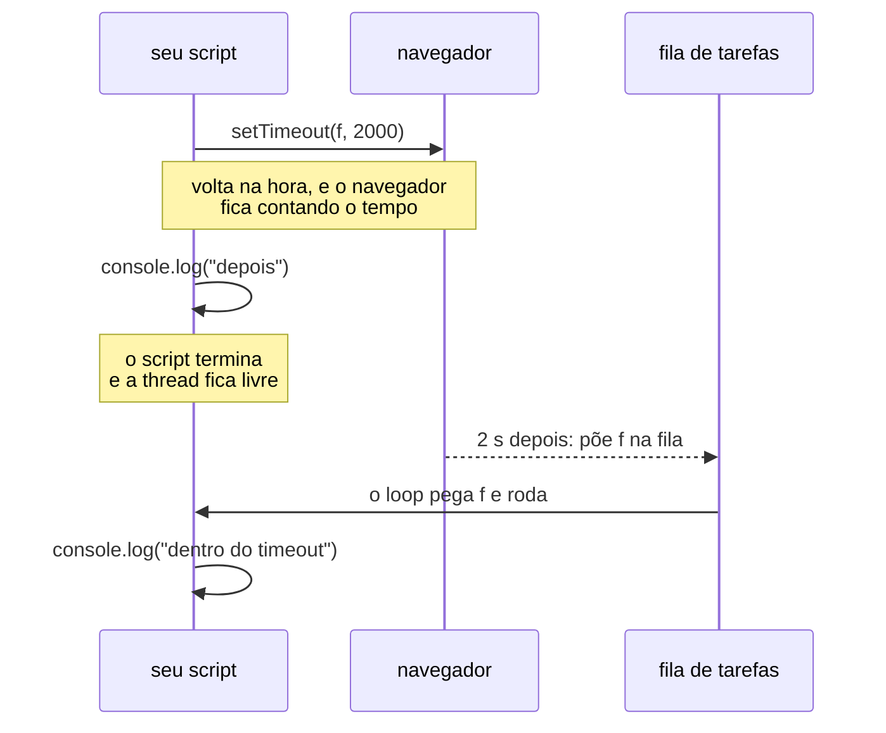

# JavaScript: a página ganha vida

## Por que isso importa

O painel do capítulo anterior funciona, mas repare no que acontece a cada
clique: a tela pisca, a URL muda, o mapa volta ao Brasil inteiro e o
navegador baixa a página de novo. Para três botões, tudo bem. Para uma
busca que filtre enquanto você digita, não dá: ninguém quer uma
recarga por tecla. O servidor está longe, cada ida e volta custa décimos
de segundo, e o usuário está **ali**, na frente da página.

O **JavaScript** é a linguagem que roda ali, dentro do navegador, na
máquina do usuário. É a única. Você pode escrever o servidor em Python,
Go, Java ou Rust; a parte que reage a um clique sem perguntar ao servidor
é JavaScript, e isso não é escolha sua. Você já escreveu alguns: o
`<script>` do mapa, com `fetch`, `L.map` e `mapa.on("click", ...)`, é
JavaScript de verdade, copiado sem muita cerimônia. Este capítulo é a
cerimônia.

A ideia é fazer com o JavaScript o que o capítulo de terminal fez com o
shell: entender o modelo, não decorar a sintaxe. O que é o **DOM**, a
árvore que o JavaScript enxerga; o que é um **evento** e por que o código
"espera" o usuário; e, o mais importante para quem vem do Python, por que
o JavaScript **nunca bloqueia** e como isso muda o jeito de escrever
código. No caminho, o painel ganha filtros instantâneos, uma busca, um
botão "onde estou" e um "copiar link", tudo com funções do próprio
navegador, sem biblioteca nenhuma. Vamos aprender a **depurar** no
DevTools, porque o JavaScript falha em silêncio mais do que o Python. E
fechamos com uma história: por que o **jQuery** existiu, por que todo
projeto antigo tem um, e por que hoje você quase não precisa dele.

## Onde o JavaScript é forte, onde é fraco

Primeiro a sinceridade. O JavaScript foi escrito em 1995, em dez dias,
por Brendan Eich na Netscape, para dar algum movimento a páginas
estáticas. Nunca foi pensado para o que faz hoje. Trinta anos de
evolução deram a ele muita coisa boa e deixaram algumas marcas.

**Onde ele é forte:**

- **Reagir ao usuário na hora.** Um clique, uma tecla, o mouse passando:
  o código responde em milissegundos, sem viagem ao servidor. É o que faz
  um mapa ser arrastável e uma busca filtrar enquanto você digita.
- **É o navegador.** Ele conhece a página inteira (o DOM), a posição do
  usuário (geolocalização), a área de transferência, a câmera, o
  armazenamento local. Nenhuma outra linguagem tem esse acesso.
- **Uma linguagem só, dos dois lados.** Com o Node.js (2009), o mesmo
  JavaScript roda no servidor, e muita equipe usa isso para não trocar de
  linguagem. Não é o nosso caso: o servidor do `pontos` é Python, e vai
  continuar sendo.
- **Ecossistema enorme.** O npm é o maior repositório de pacotes que
  existe. Leaflet, Bootstrap, o Swagger UI: tudo JavaScript, pronto para
  carregar de uma CDN.

**Onde ele é fraco:**

- **Converte tipos sem avisar.** Abra o console do navegador (`F12`, aba
  Console) e digite:

  ```javascript
  "1" + 1
  // '11'
  "1" - 1
  // 0
  1 == "1"
  // true
  1 === "1"
  // false
  [10, 9, 1].sort()
  // [1, 10, 9]
  ```

  O `+` com um texto concatena; o `-` converte para número; `==` converte
  antes de comparar e `===` não. O Python levantaria `TypeError` na
  primeira linha. A regra prática: **sempre `===`**, e converta você mesmo
  com `Number(x)` ou `String(x)` quando precisar. (O `sort` ordena como
  texto por padrão; passe uma função de comparação para números.)
- **Uma thread só.** Todo o seu código, mais o desenho da página, numa
  única fila. Um loop demorado congela a aba inteira. A seção sobre o loop
  de eventos é sobre conviver com isso.
- **Biblioteca padrão magra.** O Python vem com `csv`, `json`, `datetime`,
  `pathlib`, `sqlite3`. O JavaScript do navegador vem com `JSON`, `Date` (que
  é ruim) e pouco mais. Para o resto, pacote.
- **Falha em silêncio.** Um id errado devolve `null` e o código segue até
  explodir três linhas depois; um nome de evento com erro de digitação
  simplesmente nunca dispara. A seção de depuração é para isso.

Nada disso é motivo para fugir dele. É motivo para usá-lo no que ele é
bom: a parte da aplicação que está na frente do usuário.

## O DOM: a árvore que o JavaScript enxerga

O capítulo anterior mostrou que o navegador lê o HTML e monta uma árvore,
o **DOM**. Agora a parte que importa: essa árvore é feita de **objetos**,
e o JavaScript pode **ler e alterar** cada um. A página que você vê é a
árvore desenhada; mude a árvore, e a página muda, na hora, sem recarregar.

Abra o painel em <http://localhost:8000/lugares/mapa/>, aperte `F12` e
vá à aba **Console**. Tudo o que você digitar ali roda na página.
Experimente:

```javascript
document.title
// 'Painel dos lugares'

document.getElementById("total")
// <p class="display-5 mb-0" id="total">5</p>

document.getElementById("total").textContent
// '5'

document.getElementById("total").textContent = "42"
// '42'
```

Olhe para a página: o número do card virou 42. Você acabou de alterar o
DOM. Recarregue, e volta a 5, porque o HTML que o servidor manda não
mudou; só a cópia na memória do navegador.

O `document` é a raiz da árvore. `getElementById` é a pergunta mais
simples que se faz a ela: "me dê **o** elemento com este id". Lembra do
capítulo anterior, `id` é um elemento só, `class` é uma família? Aqui
está a consequência. Para famílias, e para qualquer seletor de CSS, há
`querySelector` (o primeiro que casar) e `querySelectorAll` (todos):

```javascript
document.querySelector(".btn.active").textContent
// 'Todas'

document.querySelectorAll(".btn").length
// 6

for (const botao of document.querySelectorAll(".btn")) {
  botao.classList.add("btn-lg");
}
```

Os botões cresceram. O `classList` é a lista de classes do elemento, com
`add`, `remove`, `toggle` e `contains`. É o jeito certo de mudar a
aparência pelo JavaScript: você não escreve CSS no código, você troca a
classe e deixa a regra do CSS fazer o trabalho. É assim que o botão
"apertado" vai funcionar daqui a pouco: `classList.add("active")`.

Uma aba ao lado, **Elements**, mostra a árvore inteira. Vale insistir num
ponto: o que você vê ali **não é o arquivo HTML**. É o DOM, agora, depois
de tudo o que o JavaScript fez. Clique num botão de zoom do mapa e veja a
árvore mudar enquanto o Leaflet cria e apaga `img` de tiles. Se o seu
código mudou alguma coisa e você não sabe o quê, Elements é onde olhar.

As operações que você vai usar o tempo todo cabem numa tabela:

| O que                        | Como                                                        |
|:-----------------------------|:------------------------------------------------------------|
| Achar um elemento pelo id    | `document.getElementById("x")`                              |
| Achar o primeiro por seletor | `document.querySelector(".btn.active")`                     |
| Achar todos por seletor      | `document.querySelectorAll("[data-categoria]")`             |
| Ler ou mudar o texto         | `el.textContent`                                            |
| Ler ou mudar o valor de um campo | `el.value`                                              |
| Classes                      | `el.classList.add("a")`, `.remove("a")`, `.toggle("a")`     |
| Atributos `data-*`           | `el.dataset.categoria` lê `data-categoria="..."`            |
| Criar e inserir              | `document.createElement("li")`, `pai.append(filho)`         |
| Remover                      | `el.remove()`                                               |
| Subir na árvore              | `el.parentElement`, `el.closest(".card")`                   |

Um aviso sobre `innerHTML`: ele existe, e permite escrever HTML dentro de
um elemento como texto. É o mesmo problema do `bindPopup` do capítulo de
GeoJSON: se o texto vier do usuário, vira um buraco de segurança. Use
`textContent` para texto e `createElement` para estrutura; deixe
`innerHTML` para HTML que você mesmo escreveu.

## Eventos: o código espera o usuário

Um script de Python começa em cima, roda até embaixo e acaba. Um script
de página roda até embaixo em alguns milissegundos e então... fica. A
página continua aberta, e o código precisa de um jeito de dizer "quando
o usuário fizer tal coisa, rode isto". Esse jeito é o **evento**.

```javascript
const botao = document.querySelector("[data-categoria='Café']");
botao.addEventListener("click", () => {
  console.log("clicou no Café");
});
```

Cole no console e clique no botão Café: `clicou no Café` aparece a cada
clique. `addEventListener` recebe o **nome** do evento (`click`, `input`,
`submit`, `keydown`, `mouseover`...) e uma **função**, que o navegador
guarda e chama quando o evento acontecer. A função é um
*callback*: você não a chama; você a entrega e alguém chama depois. O
`mapa.on("moveend", carregarLugares)` do Leaflet é a mesma ideia com
outro nome.

A função recebe um objeto com os detalhes do evento: em `(evento) => ...`,
`evento.target` é o elemento clicado, `evento.key` é a tecla, e
`evento.preventDefault()` cancela o que o navegador faria por conta própria
(seguir um link, enviar um formulário). O padrão de quase todo código de
interface é **achar, ouvir, mudar**: encontre o elemento, registre o
ouvinte, e dentro dele altere o DOM.

### O painel sem recarregar

Hora de aplicar isso ao painel. Três mudanças no template: os botões de
categoria deixam de ser links `<a href="?categoria=...">` e viram
`<button>` com um atributo `data-categoria`; o número do card ganha um
`id`; e o script sai do HTML para um arquivo estático,
`lugares/static/lugares/painel.js`, carregado no `<head>` com `defer`.
Em `lugares/templates/lugares/mapa.html`:

```html
  <script src="https://unpkg.com/leaflet@1.9.4/dist/leaflet.js"
          integrity="sha256-20nQCchB9co0qIjJZRGuk2/Z9VM+kNiyxNV1lvTlZBo=" crossorigin=""></script>
  <script src="" defer></script>
</head>
```

```html
        <div class="card mb-3">
          <div class="card-body">
            <h2 class="card-title fs-6 text-uppercase text-secondary">Lugares na tela</h2>
            <p class="display-5 mb-0" id="total">{{ total }}</p>
          </div>
        </div>

        <h2 class="fs-6 text-uppercase text-secondary">Categorias</h2>
        <div class="btn-group-vertical w-100 mb-3">
          <button type="button" class="btn btn-outline-primary active"
                  data-categoria="">Todas</button>
          
            <button type="button" class="btn btn-outline-primary active"
                    data-categoria="{{ c.nome }}">{{ c.nome }}</button>
          
        </div>
```

```html
      <main class="col-md-9 p-0">
        <div id="mapa"
             data-url-lugares=""
             data-url-bairros=""
             data-url-onde=""></div>
      </main>
```

E o `<script>` inteiro do fim do `body` é apagado. Dois detalhes:

- **`defer`** diz ao navegador: baixe o arquivo agora, mas só rode depois
  que o HTML inteiro virar DOM. Sem isso, um script no `<head>` roda antes
  de o `<p id="total">` existir, e `getElementById` devolve `null`. (Era
  por isso que o script ficava no fim do `body`; `defer` é o jeito limpo.)
- **`data-*`**: o arquivo `.js` não passa pelo sistema de templates, então
  `` não funciona nele. O jeito padrão de o servidor passar
  valores ao script é escrevê-los em atributos `data-` de algum elemento,
  que o JavaScript lê com `dataset`. `data-url-lugares` vira
  `dataset.urlLugares` (o hífen vira camelCase).

Agora o `painel.js`. Os passos 1 a 5 são o script dos capítulos de
GeoJSON e de polígonos, com três mudanças: as URLs vêm do `dataset`, a
resposta do servidor fica guardada numa variável em vez de ir direto ao
mapa, e uma função `mostrarLugares` decide o que aparece. O passo 6 é
novo:

```javascript
// O comportamento do painel dos lugares.
// Carregado com <script defer>: roda depois que o HTML inteiro virou DOM.

// 0. O que o servidor deixou para nós: as URLs, nos atributos data- da div do mapa
const divMapa = document.getElementById("mapa");
const URLS = divMapa.dataset;   // { urlLugares, urlBairros, urlOnde }

// 1. O mapa, centrado no Brasil. Aqui a ordem é [latitude, longitude]!
const mapa = L.map("mapa").setView([-15.79, -47.88], 4);

// 2. Os tiles e 3. os bairros: iguais aos capítulos anteriores,
//    trocando "" por URLS.urlBairros
// ...

// 4. Os lugares: o servidor manda o que está na tela; o filtro é aqui
const camadaLugares = L.geoJSON(null, {
  onEachFeature: (feature, camada) => {
    const p = feature.properties;
    camada.bindPopup(`<strong>${escapar(p.nome)}</strong><br>${escapar(p.categoria)}`);
  },
}).addTo(mapa);

let lugaresNaTela = [];        // a última resposta do servidor
let categoriaAtual = new URLSearchParams(location.search).get("categoria") || "";

function mostrarLugares() {
  const visiveis = lugaresNaTela.filter((feature) => {
    const p = feature.properties;
    return !categoriaAtual || p.categoria === categoriaAtual;
  });
  camadaLugares.clearLayers();
  camadaLugares.addData({ type: "FeatureCollection", features: visiveis });
  document.getElementById("total").textContent = visiveis.length;
}

function carregarLugares() {
  const bbox = mapa.getBounds().toBBoxString();  // "oeste,sul,leste,norte"
  fetch(`${URLS.urlLugares}?bbox=${bbox}`)
    .then((resposta) => resposta.json())
    .then((dados) => {
      lugaresNaTela = dados.features;
      mostrarLugares();
      console.log(`${dados.features.length} lugares na tela`);
    });
}

mapa.on("moveend", carregarLugares);
carregarLugares();

// 5. Clique no mapa: "em que bairro estou?", igual ao capítulo de polígonos
// ...

// 6. Os botões de categoria: achar, ouvir, mudar
for (const botao of document.querySelectorAll("[data-categoria]")) {
  botao.addEventListener("click", () => {
    categoriaAtual = botao.dataset.categoria;
    document.querySelector("[data-categoria].active").classList.remove("active");
    botao.classList.add("active");
    mostrarLugares();
  });
}
```

Leia o passo 6 com calma, porque ele é o capítulo inteiro em oito
linhas. **Achar**: `querySelectorAll("[data-categoria]")` pega os quatro
botões (o seletor `[atributo]` é CSS, "quem tem esse atributo"). **Ouvir**:
para cada um, um `addEventListener("click", ...)`. **Mudar**: dentro do
ouvinte, guarda a categoria do botão clicado, tira a classe `active` de
quem tinha e põe no clicado, e chama `mostrarLugares`, que refaz o filtro
sobre os dados que já estão na memória. Nenhum `fetch`: o servidor já
mandou os lugares da tela; escolher quais mostrar é trabalho do
navegador. A `URLSearchParams` no começo lê o `?categoria=` da URL, para o
link copiado do capítulo anterior continuar funcionando.

Recarregue a página e clique em **Café**. O botão fica azul... e a
contagem vai a **0**, e todos os marcadores somem. Não era para ser
assim. Bem-vindo ao JavaScript: nenhum erro no console, nenhuma pista.
Vamos depurar do jeito mais simples, que é perguntar aos dados. Ponha um
`console.log` dentro do filtro:

```javascript
  const visiveis = lugaresNaTela.filter((feature) => {
    const p = feature.properties;
    console.log(p.categoria, categoriaAtual, p.categoria === categoriaAtual);
    return !categoriaAtual || p.categoria === categoriaAtual;
  });
```

Recarregue, clique em Café, e o console mostra:

```
▸ ['Café'] 'Café' false
▸ ['Café'] 'Café' false
▸ ['Parque'] 'Café' false
```

A `categoria` que vem do servidor é `['Café']`, uma **lista** com um
item, e não o texto `'Café'`. O capítulo de GeoJSON avisou: a natural key
do Django é uma tupla, e o serializador a escreve como lista. No popup
isso nunca apareceu, porque `${p.categoria}` dentro de um template
literal converte a lista para texto, e `['Café']` vira `Café`. É a
conversão silenciosa da primeira seção trabalhando contra você: o mesmo
valor parece texto num lugar e é lista no outro, e `===` entre uma lista
e um texto é sempre `false`. A correção é um `[0]`:

```javascript
    // o serializer escreve a chave natural como lista: ["Café"], não "Café"
    const daCategoria = !categoriaAtual || p.categoria[0] === categoriaAtual;
```

Tire o `console.log`, recarregue, clique em Café: **2**, dois marcadores,
sem piscar, sem a URL mudar, com o mapa onde estava. Clique em Parque,
em Museu, em Todas. Cada clique é um evento, um ouvinte, uma alteração
no DOM. Guarde a técnica: diante de um "não funciona e não dá erro", o
primeiro passo é `console.log` nos valores que você **acha** que conhece.
Um deles não é o que você acha.

## O loop de eventos, comparado com o Python

Esta é a seção para quem vem do Python. Ela explica o `.then` que você
vem copiando desde o capítulo de GeoJSON, e por que o JavaScript é
escrito do jeito que é.

Comece pelo Python. Salve e rode:

```python
import time

print("antes")
time.sleep(2)
print("depois")
```

```bash
uv run python espera.py
# antes
# depois
```

Entre uma linha e outra, dois segundos em que o programa **para**. É o
que `sleep` faz, e é também o que `httpx.get` faz enquanto a resposta
não chega, o que `Lugar.objects.all()` faz enquanto o Postgres responde,
o que `input()` faz enquanto você não digita. O Python **bloqueia**: a
linha seguinte só roda quando a atual termina. É simples de ler, e o
capítulo de clientes de API viveu bem com isso.

Agora o equivalente em JavaScript. Cole no console da página:

```javascript
console.log("antes");
setTimeout(() => console.log("dentro do timeout"), 2000);
console.log("depois");
```

```
antes
depois
dentro do timeout      ← dois segundos mais tarde
```

`setTimeout` recebe uma função e um tempo em milissegundos e **volta
imediatamente**. O "depois" sai na hora; a função entregue só roda dois
segundos mais tarde. Enquanto isso, a página responde: você consegue
arrastar o mapa, clicar nos botões. Nada parou.

Como isso funciona? Lembre que há **uma thread só**. Se ela parasse dois
segundos, a página inteira congelaria: nenhum clique, nenhum redesenho.
Então o JavaScript não para nunca. O que existe é uma **fila de tarefas**
e um **loop** que a esvazia:



Cada coisa que leva tempo (um timer, uma requisição `fetch`, um clique
que ainda não aconteceu) é entregue ao navegador com uma função, o
callback. O navegador cuida da espera **fora** da thread do JavaScript.
Quando a coisa termina, ele põe o callback na fila. O loop de eventos é
um `while` eterno: "a thread está livre? pega a próxima tarefa da fila e
roda". Os ouvintes de evento são isso: o clique acontece, o navegador
enfileira o seu `addEventListener`, o loop roda. O `setTimeout` é isso. O
`fetch` é isso.

A consequência prática: **nunca escreva código que ocupe a thread**.
Cole no console:

```javascript
console.log("começou");
const fim = Date.now() + 2000;
while (Date.now() < fim) {}   // 2 segundos ocupando a única thread
console.log("terminou");
```

Durante esses dois segundos, tente arrastar o mapa. Não dá. Nem o botão
de zoom responde, nem a página rola. O loop de eventos está preso na
sua tarefa, a fila acumula, e tudo o que o usuário faz espera. É isso
que um `sleep` faria no navegador, e é por isso que ele não existe lá.

### Promises: o `.then` explicado

O `fetch` segue a mesma lógica, com uma embalagem mais arrumada. Cole:

```javascript
console.log("1. vou pedir");
fetch("/lugares/api/lugares.geojson")
  .then((resposta) => resposta.json())
  .then((dados) => console.log("3. chegaram", dados.features.length, "lugares"));
console.log("2. pedi, sigo em frente");
```

```
1. vou pedir
2. pedi, sigo em frente
3. chegaram 5 lugares
```

A ordem 1, 2, 3 é o loop de eventos de novo: o `fetch` entrega o pedido
ao navegador e volta na hora; o "2" roda; a resposta chega, o callback vai
para a fila, o "3" roda. A diferença para o `setTimeout` é o que o
`fetch` devolve: uma **Promise**, um objeto que representa "um valor que
ainda vai chegar". O `.then(função)` registra o que fazer quando chegar,
e devolve outra Promise, o que permite encadear: a resposta vira JSON
(que também demora, porque o corpo ainda está sendo baixado), o JSON vira
a lista de lugares. Um `.catch(erro => ...)` no fim recebe qualquer falha
da cadeia, como o `except` de um `try`.

Há uma sintaxe mais nova que faz a mesma coisa parecendo Python:

```javascript
async function carregarLugares() {
  const resposta = await fetch(`${URLS.urlLugares}?bbox=${bbox}`);
  const dados = await resposta.json();
  lugaresNaTela = dados.features;
  mostrarLugares();
}
```

`await` pausa **esta função** até a Promise resolver, mas não a thread:
enquanto ela espera, o loop roda outras tarefas. Só pode ser usado
dentro de uma função marcada `async`, que por sua vez devolve uma
Promise. É o que o botão "copiar link" vai usar daqui a pouco. Os dois
estilos são equivalentes; `.then` é mais comum em código curto, `async`
em funções com vários passos.

### E o Python?

O Python tem exatamente o mesmo modelo, opcional, no módulo `asyncio`:

```python
import asyncio


async def demora(nome, segundos):
    print(f"{nome}: começou")
    await asyncio.sleep(segundos)
    print(f"{nome}: terminou")


async def main():
    await asyncio.gather(demora("A", 2), demora("B", 1))


asyncio.run(main())
```

```bash
uv run python concorrente.py
# A: começou
# B: começou
# B: terminou
# A: terminou
```

As duas funções "rodam ao mesmo tempo" numa thread só: enquanto A
espera, B avança. É o loop de eventos, com `async`/`await` iguais aos do
JavaScript (o JavaScript veio primeiro, e o Python copiou a sintaxe em
2015). A diferença é cultural: no Python o modo bloqueante é o padrão e o
`asyncio` é uma escolha para servidores com muitas conexões; no navegador
o loop de eventos é o **único** modo, porque a página não pode parar.
Quem entendeu um entende o outro.

## Ferramentas pequenas com funções básicas

Com o modelo na cabeça, três ferramentas para o painel, cada uma com
menos de vinte linhas e só com o que o navegador oferece. No template,
dentro do `aside`, antes das categorias e depois delas:

```html
        <label for="busca" class="fs-6 text-uppercase text-secondary">Buscar</label>
        <input id="busca" type="search" class="form-control mb-3" placeholder="Parte do nome">
```

```html
        <div class="d-flex gap-2 mb-3">
          <button type="button" id="onde-estou" class="btn btn-secondary btn-sm">Onde estou</button>
          <button type="button" id="copiar" class="btn btn-secondary btn-sm">Copiar link</button>
        </div>
```

### A busca

Um campo que filtra a cada tecla. O evento é `input`, que dispara a cada
mudança no valor (ao contrário de `change`, que espera o campo perder o
foco). No `painel.js`, uma variável a mais no filtro e um ouvinte:

```javascript
let termoDeBusca = "";

function mostrarLugares() {
  const visiveis = lugaresNaTela.filter((feature) => {
    const p = feature.properties;
    const daCategoria = !categoriaAtual || p.categoria[0] === categoriaAtual;
    const bateComABusca = p.nome.toLowerCase().includes(termoDeBusca.toLowerCase());
    return daCategoria && bateComABusca;
  });
  // ... o resto igual
}

// 7. A busca: filtra a cada tecla
document.getElementById("busca").addEventListener("input", (evento) => {
  termoDeBusca = evento.target.value;
  mostrarLugares();
});
```

Digite `rio`: sobra o Café do Rio, contagem **1**. Apague: volta a 5. Com
Café selecionado e `rio` digitado, os dois filtros se combinam. Repare
que a busca não pergunta nada ao servidor; os dados já estão em
`lugaresNaTela`. Com cinco lugares (ou quinhentos) isso é instantâneo.
Com cinquenta mil seria o caso de mandar o termo na URL do `fetch` e
deixar o Postgres filtrar, como o `bbox` já faz. Saber de que lado
filtrar é uma decisão que você vai tomar muitas vezes.

### Onde estou

O navegador sabe (ou estima) a posição do usuário, e a entrega mediante
permissão, por uma API assíncrona no estilo callback:

```javascript
// 8. "Onde estou": a posição vem do navegador, com a permissão do usuário
document.getElementById("onde-estou").addEventListener("click", () => {
  navigator.geolocation.getCurrentPosition(
    (posicao) => mapa.setView([posicao.coords.latitude, posicao.coords.longitude], 14),
    (erro) => alert(`Não deu para achar você: ${erro.message}`),
  );
});
```

`getCurrentPosition` recebe duas funções: a de sucesso, com a posição, e
a de erro (permissão negada, sem sinal). Ela volta na hora, o navegador
pergunta ao usuário, e um dos callbacks entra na fila quando houver
resposta. Clique: o navegador pede permissão, e o mapa pula para onde
você está, com zoom 14. O `moveend` dispara, `carregarLugares` busca os
lugares daquela área, e a contagem muda. Só funciona em `localhost` ou
`https`; o navegador recusa a posição em páginas `http` comuns.

### Copiar link

O painel já não muda a URL quando você filtra, mas às vezes você quer
mandar "os cafés" para alguém. Monte a URL e ponha na área de
transferência:

```javascript
// 9. "Copiar link": a URL com a categoria atual vai para a área de transferência
document.getElementById("copiar").addEventListener("click", async (evento) => {
  const url = new URL(location.href);
  url.searchParams.set("categoria", categoriaAtual);
  await navigator.clipboard.writeText(url.href);
  const botao = evento.target;
  botao.textContent = "Copiado!";
  setTimeout(() => { botao.textContent = "Copiar link"; }, 1500);
});
```

Três coisas do capítulo juntas: `URL` e `searchParams` montam
`http://localhost:8000/lugares/mapa/?categoria=Parque` sem você
concatenar texto; `clipboard.writeText` devolve uma Promise, por isso o
ouvinte é `async` e usa `await`; e o `setTimeout` devolve o texto do
botão depois de um segundo e meio, sem travar nada. Clique em Parque,
depois em Copiar link, e cole em algum lugar. Abra a URL colada numa aba
nova: o `URLSearchParams` do começo do script lê a categoria, e a view do
capítulo anterior ainda marca o botão certo no HTML que ela entrega.

> **O teste quebrou.** Ao rodar `uv run pytest`, o
> `test_painel_filtra_por_categoria` do capítulo anterior falha: ele
> procurava o texto "na categoria Café", que saiu do template. É o
> lembrete daquela seção: afirme sobre o que importa. Troque a última
> linha por duas que sobrevivem a mudanças de layout:
>
> ```python
>     assert resposta.context["categoria"] == "Café"
>     assertContains(resposta, 'data-categoria="Café"')
> ```

## Depurando

O Python avisa. Um nome errado é `NameError` na linha certa, com
traceback. O JavaScript do navegador avisa menos, e quando avisa, é num
lugar que você precisa saber abrir. Os instrumentos, do mais simples ao
mais poderoso:

**`console.log`.** Foi o que resolveu o bug da lista. Aceita vários
argumentos, e mostra objetos e listas de forma navegável (o `▸` que você
clica para expandir). Dois irmãos úteis: `console.table(lista)` mostra
uma lista de objetos como tabela, e `console.error` escreve em vermelho.
O limite: você só vê o que lembrou de imprimir, e precisa editar, salvar
e recarregar a cada tentativa.

**A aba Console.** Além de mostrar os logs, é onde os **erros** aparecem,
em vermelho, com o arquivo e a linha. Se algo não funciona, olhe aqui
**primeiro**. O erro mais comum do JavaScript de interface:

```
Uncaught TypeError: Cannot set properties of null (setting 'textContent')
    at mostrarLugares (painel.js:52)
```

"Não dá para definir propriedades de `null`" quer dizer: algum
`getElementById` ou `querySelector` não achou nada e devolveu `null`, e
você tentou usar o resultado. As causas, em ordem de probabilidade: o id
está escrito diferente no HTML e no JavaScript (`total` e `totl`); o
script rodou antes de o elemento existir (faltou o `defer`); ou o
elemento é criado depois por outro código. As linhas `at ...` embaixo
são o **stack trace**, lido de cima para baixo: a função onde explodiu,
quem a chamou, quem chamou essa. Clique em `painel.js:52` e o DevTools
abre a linha.

**A aba Network.** Mostra cada requisição que a página fez: os tiles, o
Bootstrap, e os `fetch` para a API. Clique numa linha
`lugares.geojson?bbox=...` e veja a URL exata, o status, e em
**Response** o JSON que voltou. Se a sua view devolveu 500, ou o JSON não
tem o campo que você esperava, é aqui que se descobre, sem um
`console.log` sequer. O bug da lista também se via aqui, no
`"categoria": ["Café"]` da resposta.

**Breakpoints.** Na aba **Sources**, abra `painel.js` (fica em
`localhost:8000/static/lugares/`), clique no número de uma linha dentro
de `mostrarLugares` e clique num botão de categoria. A página **para**
naquela linha. À direita, **Scope** mostra todas as variáveis com seus
valores naquele instante: `p`, `categoriaAtual`, `visiveis`. Os botões
em cima avançam linha a linha (*step over*), entram numa função (*step
into*) ou continuam (*resume*). É o `pdb` do navegador, e para um bug de
lógica é muito mais rápido que `console.log`. A mesma coisa pelo código:
escreva `debugger;` numa linha, e o DevTools para ali quando estiver
aberto.

**Os três erros silenciosos.** Estes não dão mensagem nenhuma, e por isso
merecem uma lista:

1. **Nome de evento errado.** `addEventListener("clique", ...)` registra um
   ouvinte para um evento chamado "clique", que nunca vai acontecer. Nada
   roda, nada avisa. Confira o nome na documentação da MDN: `click`,
   `input`, `change`, `submit`, `keydown`.
2. **Script antes do DOM.** Sem `defer` e no `<head>`, `getElementById`
   devolve `null`. Este ao menos vira o `TypeError` acima, mas só se você
   usar o resultado; se só registrar um ouvinte em `null`... erro
   também. Se guardar o `null` para depois, silêncio.
3. **Seletor que casa com outra coisa.** `querySelector(".btn")` devolve o
   **primeiro** `.btn` da página, que pode ser o da barra de navegação, não
   o que você queria. Teste o seletor no console antes de usar.

Um hábito que vale mais que todos os instrumentos: quando algo não
funciona, **primeiro o Console** (tem erro?), **depois o Network** (o
servidor respondeu o que eu acho?), **depois `console.log` ou breakpoint**
nos valores que você supõe conhecer. Nessa ordem, a maioria dos bugs cai
em cinco minutos.

## jQuery: por que existiu e por que ainda está por aí

Abra o código-fonte de qualquer projeto Django com mais de cinco anos e
você vai achar um `$(document).ready(function() { ... })`. Isso é
**jQuery**, e é provável que você o encontre antes de encontrar
`addEventListener`. Para entender por que, é preciso voltar a uma web que
não existe mais.

### As guerras dos navegadores

A linha do tempo, resumida:

| Ano  | O que aconteceu                                                            |
|:-----|:---------------------------------------------------------------------------|
| 1995 | Netscape cria o JavaScript                                                 |
| 1996 | Microsoft responde com o JScript no Internet Explorer 3, "parecido"        |
| 1997 | Primeira padronização, o ECMAScript 1 (a linguagem; o DOM fica de fora)    |
| 2001 | Internet Explorer 6: com ~95% do mercado, a Microsoft para de evoluir      |
| 2004 | Firefox 1.0; a concorrência volta                                          |
| 2006 | **jQuery 1.0**, de John Resig                                              |
| 2008 | Google Chrome, com o motor V8: o JavaScript fica dez vezes mais rápido     |
| 2009 | ECMAScript 5 e o Node.js                                                   |
| 2011 | Internet Explorer 9 finalmente implementa `addEventListener`               |
| 2015 | ECMAScript 2015: `let`, `const`, arrow functions, Promises, classes        |
| 2017 | `fetch` e `async`/`await` em todos os navegadores grandes                  |
| 2022 | A Microsoft aposenta o Internet Explorer                                   |

O problema não era a linguagem, que o ECMAScript padronizou cedo. Era o
**DOM**: a parte que fala com a página. Cada navegador implementou a sua,
e durante uns dez anos escrever JavaScript era escrever tudo duas vezes.
Alguns exemplos reais:

| O que você queria            | Netscape / Firefox / Safari          | Internet Explorer (até o 8)            |
|:-----------------------------|:-------------------------------------|:---------------------------------------|
| Ouvir um clique              | `el.addEventListener("click", f)`    | `el.attachEvent("onclick", f)`         |
| Saber o que foi clicado      | `evento.target`                      | `window.event.srcElement`              |
| Fazer uma requisição         | `new XMLHttpRequest()`               | `new ActiveXObject("Microsoft.XMLHTTP")` |
| Ler o texto de um elemento   | `el.textContent`                     | `el.innerText`                         |
| A opacidade de um elemento   | `opacity: 0.5`                       | `filter: alpha(opacity=50)`            |

E o IE6, lançado em 2001, ficou no ar até depois de 2010, porque empresas
inteiras tinham sistemas internos que só funcionavam nele. Todo código
de página começava com um `if (el.addEventListener) { ... } else if
(el.attachEvent) { ... }`.

### O que o jQuery fez

John Resig lançou o jQuery em 2006 com uma ideia simples: **uma função,
`$`, que recebe um seletor CSS e devolve um objeto que funciona igual em
todos os navegadores**. Por dentro, o `if (addEventListener) else
attachEvent` continuava lá; mas estava lá **uma vez**, escrito e testado
por outra pessoa. E, de quebra, a API era mais curta e mais agradável que
a do DOM da época (que não tinha `querySelector`; isso só chegou em 2009).

Compare as três operações básicas, no jQuery e no JavaScript de hoje:

```javascript
// Achar
$("#total")                               // jQuery
document.getElementById("total")          // hoje

// Ouvir
$("#copiar").on("click", function () { ... });          // jQuery
document.getElementById("copiar").addEventListener("click", () => { ... });   // hoje

// Mudar
$("#total").text("42").addClass("destaque");             // jQuery
const total = document.getElementById("total");          // hoje
total.textContent = "42";
total.classList.add("destaque");

// Pedir ao servidor
$.getJSON("/lugares/api/lugares.geojson", function (dados) { ... });   // jQuery
fetch("/lugares/api/lugares.geojson")                                   // hoje
  .then((r) => r.json()).then((dados) => { ... });

// Esperar o DOM
$(document).ready(function () { ... });   // jQuery
<script src="painel.js" defer>            // hoje
```

Repare que o lado "hoje" é parecido, às vezes um pouco mais longo. Não
era assim em 2006: o lado da direita não existia ou não funcionava em
metade dos navegadores. O jQuery foi, por uns dez anos, a camada que
tornou o JavaScript de interface suportável, e quase toda biblioteca
desse período (plugins de calendário, de tabela, de galeria) foi
escrita em cima dele. O Bootstrap, até a versão 4, dependia dele.

### Por que hoje você quase não precisa

Três coisas aconteceram. Os navegadores **copiaram o jQuery** para dentro
do padrão: `querySelector` é o `$` com outro nome, `classList` é o
`addClass`/`removeClass`, `fetch` é o `$.ajax`. O IE morreu, e com ele a
necessidade de duas versões de tudo. E os frameworks de interface (React,
Vue, Svelte) trouxeram outro modelo, em que você não manipula o DOM
diretamente, e nos quais o jQuery não cabe.

Mas ele continua por aí. Segundo o W3Techs, está em 85% dos sites cuja
biblioteca JavaScript eles conseguem identificar, a maioria por inércia: um site feito em 2012
não reescreve o JavaScript porque surgiu um jeito novo. O **admin do
Django** carrega a sua própria cópia (a versão 3.7.1, em
`django/contrib/admin/static/admin/js/vendor/jquery/`, acessível como
`django.jQuery`), porque o código do admin foi escrito nessa época e
funciona. Você vai encontrá-lo em projetos antigos, em plugins, em
tutoriais de dez anos atrás. Quando encontrar, agora sabe o que é: uma
camada de compatibilidade que resolveu um problema real, com uma API que
o padrão depois absorveu. Para código **novo**, as funções deste capítulo
bastam; é por isso que o `painel.js` não tem um `$` sequer.

## Tabela de referência rápida

| O que                            | Como                                                                        |
|:---------------------------------|:----------------------------------------------------------------------------|
| Carregar o script                | `<script src="" defer>` no `head`                  |
| Passar valores do Django ao JS   | `data-x="{{ valor }}"` no HTML; `el.dataset.x` no JS                        |
| Achar elementos                  | `getElementById`, `querySelector`, `querySelectorAll` (seletores CSS)       |
| Texto, valor, classes            | `textContent`, `value`, `classList.add/remove/toggle`                       |
| Ouvir                            | `el.addEventListener("click", (evento) => { ... })`                         |
| Eventos mais usados              | `click`, `input` (cada tecla), `change`, `submit`, `keydown`                |
| Cancelar o padrão                | `evento.preventDefault()`                                                   |
| Esperar sem travar               | `setTimeout(f, ms)`; nunca um `while` de espera                             |
| Pedir ao servidor                | `fetch(url).then(r => r.json()).then(dados => ...)`                         |
| O mesmo, estilo Python           | `async function f() { const r = await fetch(url); const d = await r.json(); }` |
| Erros de uma Promise             | `.catch(erro => ...)` ou `try/await/catch`                                  |
| Ler a querystring                | `new URLSearchParams(location.search).get("categoria")`                     |
| Montar uma URL                   | `const u = new URL(location.href); u.searchParams.set("k", "v"); u.href`    |
| Posição do usuário               | `navigator.geolocation.getCurrentPosition(ok, erro)` (só https/localhost)   |
| Área de transferência            | `await navigator.clipboard.writeText(texto)`                                |
| Comparar                         | sempre `===`; converta com `Number()`/`String()`                            |
| Ver o que uma variável tem       | `console.log(a, b)`, `console.table(lista)`                                 |
| Parar o código                   | breakpoint em Sources, ou `debugger;`                                       |
| Ver o que o servidor respondeu   | aba Network > a requisição > Response                                       |
| `null` em `textContent`          | id errado ou script sem `defer`                                             |
| jQuery → hoje                    | `$("#x")` → `querySelector("#x")`; `.on("click")` → `addEventListener`; `$.getJSON` → `fetch`; `$(document).ready` → `defer` |

## Exercícios

### Exercício 1: limpar filtros

Acrescente um botão "Limpar" que volta a categoria para "Todas", esvazia
o campo de busca e chama `mostrarLugares`. Lembre de mover a classe
`active` e de limpar o `value` do campo (e a variável `termoDeBusca`).

### Exercício 2: congele a aba

No console, rode o `while` de dois segundos da seção do loop de eventos
com 10 segundos. Durante a espera, tente clicar em tudo. Depois faça a
mesma espera com `setTimeout` e um `console.log` no fim, e tente de novo.
Escreva com suas palavras por que uma trava e a outra não.

### Exercício 3: um breakpoint dentro do `fetch`

Em Sources, ponha um breakpoint na linha `lugaresNaTela = dados.features`
e arraste o mapa. Quando parar, expanda `dados` em Scope e ache a
`categoria` de um lugar. Avance linha a linha até `mostrarLugares` e veja
`visiveis` ser montada.

### Exercício 4: o bug do `defer`

Tire o `defer` da tag `<script>` e recarregue. Anote o erro do Console,
com a linha, e explique-o a partir da ordem em que o navegador lê o
HTML. Depois mova a tag para o fim do `body`, sem `defer`, e veja que
também funciona; explique por quê. Devolva o `defer`.

### Exercício 5: a busca em jQuery

Carregue o jQuery de uma CDN (a documentação dele mostra o `<script>`) e
reescreva só a ferramenta de busca com `$("#busca").on("input", ...)`,
`$(this).val()` e `$("#total").text(...)`. Compare o tamanho e a
legibilidade com a versão em JavaScript puro. Tire o jQuery depois.

### Exercício 6: modo escuro que lembra

Um botão que alterna a classe `bg-dark text-light` no `body`
(`classList.toggle`) e guarda a escolha com
`localStorage.setItem("tema", "escuro")`. No começo do script, leia
`localStorage.getItem("tema")` e aplique a classe antes de qualquer
coisa. Recarregue: o tema permanece. Procure na MDN o que mais o
`localStorage` guarda e o que acontece quando o usuário limpa os dados
do site.

## Referências

- **MDN, introdução ao JavaScript** (em português):
  <https://developer.mozilla.org/pt-BR/docs/Learn_web_development/Core/Scripting>.
- **MDN, o DOM**:
  <https://developer.mozilla.org/pt-BR/docs/Web/API/Document_Object_Model>,
  <https://developer.mozilla.org/pt-BR/docs/Web/API/Document/querySelector>,
  <https://developer.mozilla.org/pt-BR/docs/Web/API/Element/classList>,
  <https://developer.mozilla.org/en-US/docs/Web/API/HTMLElement/dataset>.
- **MDN, eventos e `addEventListener`**:
  <https://developer.mozilla.org/pt-BR/docs/Learn_web_development/Core/Scripting/Events>,
  <https://developer.mozilla.org/pt-BR/docs/Web/API/EventTarget/addEventListener>.
- **MDN, o loop de eventos**:
  <https://developer.mozilla.org/pt-BR/docs/Web/JavaScript/Reference/Execution_model>.
- **MDN, Promises e `async`/`await`**:
  <https://developer.mozilla.org/pt-BR/docs/Web/JavaScript/Guide/Using_promises>,
  <https://developer.mozilla.org/pt-BR/docs/Web/JavaScript/Reference/Statements/async_function>.
- **MDN, `fetch`, `URL`, geolocalização, área de transferência**:
  <https://developer.mozilla.org/pt-BR/docs/Web/API/Fetch_API/Using_Fetch>,
  <https://developer.mozilla.org/pt-BR/docs/Web/API/URL>,
  <https://developer.mozilla.org/pt-BR/docs/Web/API/Geolocation_API>,
  <https://developer.mozilla.org/en-US/docs/Web/API/Clipboard_API>.
- **MDN, igualdade e conversão de tipos**:
  <https://developer.mozilla.org/en-US/docs/Web/JavaScript/Reference/Operators/Strict_equality>.
- **MDN, `<script defer>`**:
  <https://developer.mozilla.org/pt-BR/docs/Web/HTML/Reference/Elements/script>.
- **Chrome DevTools: Console, Network e depuração com breakpoints**:
  <https://developer.chrome.com/docs/devtools/console>,
  <https://developer.chrome.com/docs/devtools/network>,
  <https://developer.chrome.com/docs/devtools/javascript>.
- **Python, `asyncio`**:
  <https://docs.python.org/pt-br/3/library/asyncio.html>.
- **jQuery, documentação e história**:
  <https://jquery.com/>, <https://api.jquery.com/>,
  <https://en.wikipedia.org/wiki/JQuery>.
- **Uso do jQuery nos sites (W3Techs)**:
  <https://w3techs.com/technologies/details/js-jquery>.
- **História do JavaScript e dos navegadores**:
  <https://en.wikipedia.org/wiki/JavaScript#History>,
  <https://en.wikipedia.org/wiki/Browser_wars>.
- **Django, o jQuery do admin (`django.jQuery`)**:
  <https://docs.djangoproject.com/en/stable/ref/contrib/admin/javascript/>.
- **You Might Not Need jQuery** (o equivalente moderno de cada chamada):
  <https://youmightnotneedjquery.com/>.
